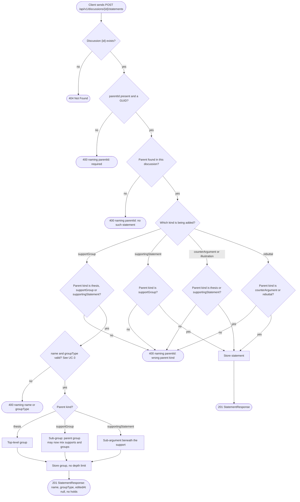
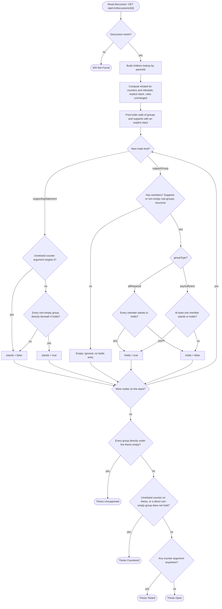
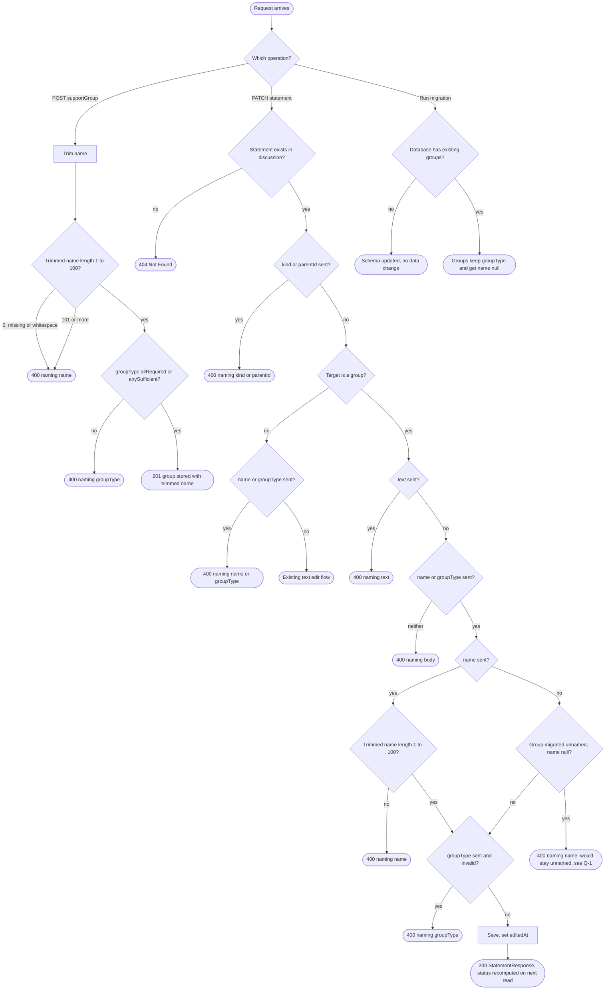
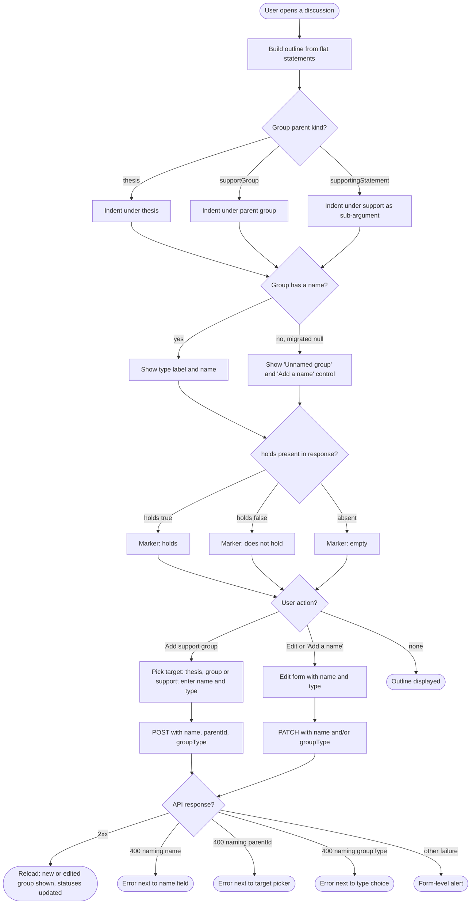
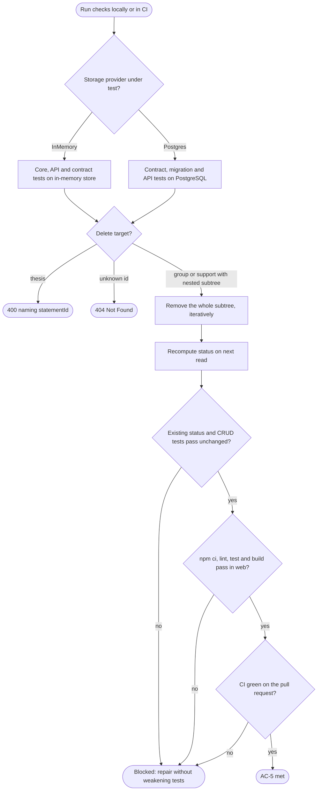
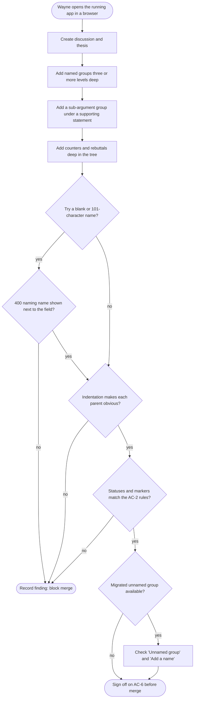
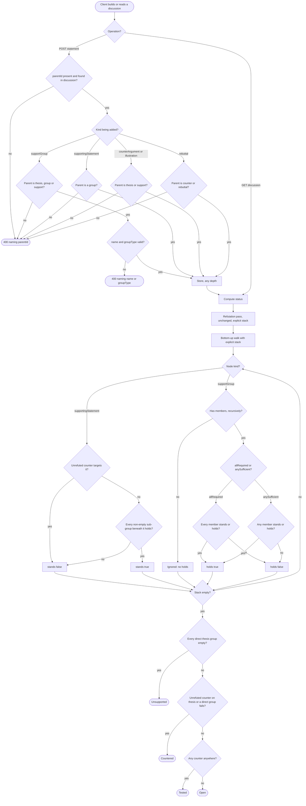
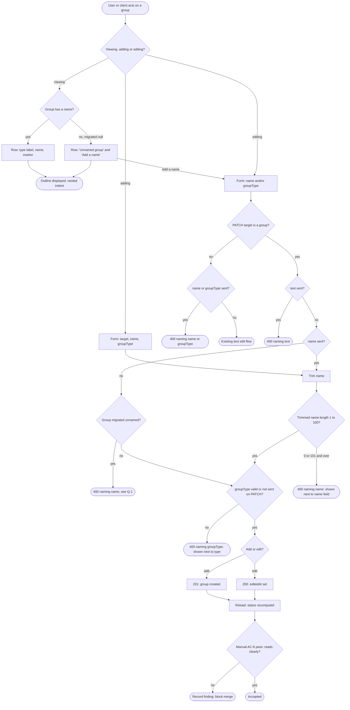
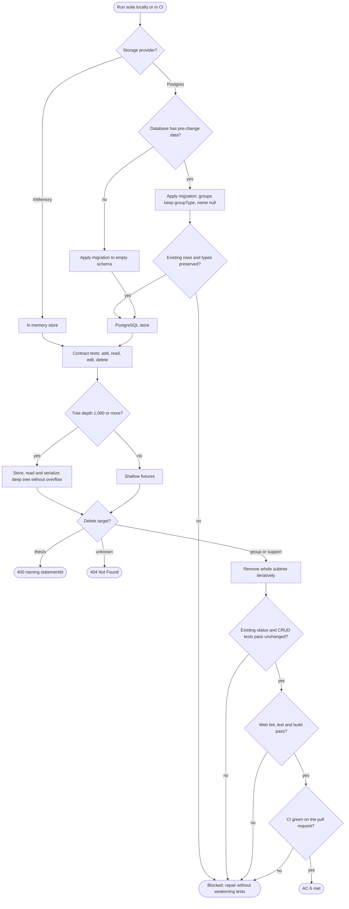

# Nested and named support groups: use cases and test design

| | |
|---|---|
| Plan | `.zeroshot/plans/nested-named-groups.md` (plan id `nested-named-groups`) |
| Requirements source | `docs/core-requirements.md` |
| Depends on | `discussion-crud-and-tags` (statement `PATCH`, `editedAt`, cascade delete, `topicTags`) |
| Scope | Use cases for AC-1 to AC-6, clustering, and the variables that drive test conditions |

This document is for designing tests only. It does not change the plan, and where the plan is ambiguous it lists
the question under [Open questions](#open-questions) and does not choose an answer.

## Conventions and grounding

The use cases use the names that exist in the code today, plus the names the plan adds:

- **Endpoints** (`src/TheDiscussion.Api/Discussions/DiscussionEndpoints.cs`, base path `/api/v1/discussions`):
  - `POST /api/v1/discussions/{id}/statements`: add a statement. Body `AddStatementRequest(kind, parentId, text, groupType)`;
    this plan adds `name` for `kind: "supportGroup"`. Returns `201` with a `StatementResponse`.
  - `PATCH /api/v1/discussions/{id}/statements/{statementId}`: edit a statement. Today it accepts only `text` and
    rejects `kind`, `parentId` and `groupType`. This plan lets a group take `name` and/or `groupType`. Returns `200`.
  - `DELETE /api/v1/discussions/{id}/statements/{statementId}`: deletes the statement and its whole subtree (`204`).
    Deleting the thesis returns `400` naming `statementId`.
  - `GET /api/v1/discussions/{id}`: a flat list of statements in creation order, each with a `parentId`. Status is
    computed again on each read.
- **Errors**: RFC 7807 problem details with a `400` response whose `errors` object is keyed by the camelCase field
  name (`parentId`, `name`, `groupType`, `text`, `kind`, `statementId`, `body`). An unknown discussion or statement
  returns `404`.
- **Statement kinds** (wire names): `thesis`, `supportGroup`, `supportingStatement`, `illustration`,
  `counterArgument`, `rebuttal`. **Group types**: `allRequired`, `anySufficient`, shown in the UI as
  `ALL REQUIRED` and `ANY SUFFICIENT` (`web/src/outline/outline.ts` `groupTypeLabels`).
- **Computed fields** (`StatementResponse`): `stands` (supporting statements), `refuted` (counters and rebuttals),
  `holds` (non-empty groups only; empty groups have no entry), and `editedAt` (always present; `null` until the
  statement is edited). The thesis status is one of **Unsupported**, **Open**, **Countered**, **Tested**
  (serialized as `unsupported`, `open`, `countered`, `tested`).
- **Parent rules today** (`DiscussionRules.AllowedParentKinds`): a `supportGroup` may attach only to `thesis`, and a
  `supportingStatement` only to `supportGroup`. `illustration` and `counterArgument` may attach to `thesis` or
  `supportingStatement`, and `rebuttal` to `counterArgument` or `rebuttal`. AC-1 widens only the `supportGroup` row.
- **Status engine today** (`ArgumentStatusEngine.Compute`): walks only the groups directly under the thesis and
  their supporting statements. Refutation is computed with an explicit stack. AC-2 replaces the group and support
  rules and keeps the refutation rules.
- **UI**: `web/src/components/Outline.tsx` renders the outline recursively (`OutlineItem`). Group rows show
  `Support group: <type>` and a `holds` / `does not hold` / `empty` marker, and there is no Edit button on group
  rows today. `web/src/components/AddStatementPanel.tsx` has the "Add support group" form (target picker plus group
  type, no name field today).
- **Storage**: `Storage:Provider` is `InMemory` (the default) or `Postgres`. PostgreSQL uses EF Core migrations
  under `src/TheDiscussion.Storage.Postgres/Migrations`, and `tests/TheDiscussion.Storage.Tests` runs the same
  store contract against both providers.

In the diagrams, rounded "stadium" nodes are end states. Rhombus nodes are decisions. Error end nodes name the HTTP
status and the field that the problem details report.

---

## 1. Use cases per acceptance criterion

### UC-1 (AC-1): Attach a support group to the thesis, a group or a supporting statement, at any depth

| | |
|---|---|
| **AC** | AC-1 |
| **Actor** | API client: the web front end, an integration test, or any HTTP caller. No accounts are involved. |
| **Preconditions** | The discussion `{id}` exists and has its thesis. To add a nested group, the intended parent (a `supportGroup` or a `supportingStatement`) already exists in the same discussion. |
| **Trigger** | `POST /api/v1/discussions/{id}/statements` with `{ "kind": "supportGroup", "parentId": "<guid>", "name": "Evidence", "groupType": "anySufficient" }` |

**Main flow**

1. The client sends the request.
2. The system parses `kind` as `supportGroup`.
3. The system checks that `parentId` is present and is a GUID.
4. The system looks up `parentId` among the statements of discussion `{id}`.
5. The system checks the parent's kind against the new allowed parents for `supportGroup`: `thesis`,
   `supportGroup` or `supportingStatement`.
6. The system validates `name` and `groupType` (see UC-3).
7. The system stores the group with `parentId` set to the parent. There is no depth limit (D-4), so a parent that
   is 1,000 or more levels deep is accepted.
8. The system returns `201` with a `StatementResponse`: `kind: "supportGroup"`, `parentId`, `name`, `groupType`,
   `editedAt: null`, and no `holds` because the new group is empty.

**Alternate flows**

- **A1, sub-group:** the parent is a `supportGroup`. The new group becomes a member candidate of that group, and
  the parent group may then mix supporting statements and sub-groups.
- **A2, sub-argument:** the parent is a `supportingStatement`. The new group sits beneath the support, and the
  support's `stands` value now depends on it (UC-2).
- **A3, supporting statement:** `kind: "supportingStatement"` still needs a `supportGroup` parent at any depth,
  whether the group sits under the thesis, under another group or under a supporting statement. A supporting
  statement whose parent is the thesis or another supporting statement is rejected (E3).
- **A4, counter argument or illustration:** these still need a `thesis` or `supportingStatement` parent. A group
  parent, nested or not, is rejected (E3). Rebuttals still need a `counterArgument` or `rebuttal` parent.

**Error flows**

- **E1:** `parentId` is missing or empty, so the system returns `400` naming `parentId`.
- **E2:** `parentId` does not match any statement in this discussion (including a statement in another
  discussion), so the system returns `400` naming `parentId`.
- **E3:** the parent's kind is not allowed for the new statement's kind, for example a group under an
  `illustration`, `counterArgument` or `rebuttal`, or a counter argument under a group. The system returns `400`
  naming `parentId`.
- **E4:** discussion `{id}` does not exist, so the system returns `404`.
- **E5:** `name` or `groupType` is invalid, so the system returns `400` naming that field (detailed in UC-3).

**Postconditions**

- Success: the group is stored under its parent, the next `GET` shows it in the flat list with that `parentId`,
  and status is recomputed.
- Failure: nothing is stored, and the discussion is unchanged.

---

### UC-2 (AC-2): Compute status over nested groups and sub-arguments

| | |
|---|---|
| **AC** | AC-2 |
| **Actor** | The system (`ArgumentStatusEngine.Compute`), on behalf of any client that reads a discussion. |
| **Preconditions** | The discussion has a thesis and any tree of groups, supporting statements, counter arguments, rebuttals and illustrations, at any depth. |
| **Trigger** | `GET /api/v1/discussions/{id}`, or a successful `POST` or `PATCH` that returns a response containing status. |

**Main flow**

1. The system loads every statement and builds a children lookup keyed by `parentId`.
2. The system computes `refuted` for every counter argument and rebuttal with the existing explicit-stack
   algorithm. This step is unchanged.
3. The system walks the support tree bottom-up with an explicit stack, not recursion, so that nesting 1,000 or
   more levels deep cannot overflow the call stack.
4. For each supporting statement it checks whether an unrefuted counter argument targets it. If none does, and
   every non-empty group directly beneath it holds, the statement **stands**. Otherwise it does not stand.
5. For each group it collects the members: its supporting statements and its **non-empty** sub-groups. A group is
   **empty** when it has no members, and this is applied recursively, so a group that holds only empty sub-groups is
   empty. Empty groups are ignored: they get no `holds` entry and do not count against their parent.
6. A non-empty `allRequired` group **holds** when every member stands (supporting statement) or holds (sub-group).
   A non-empty `anySufficient` group holds when at least one member does.
7. The system decides the thesis status:
   1. **Unsupported** when every group directly under the thesis is empty, including when there are no groups (D-6).
   2. Otherwise **Countered** when an unrefuted counter argument targets the thesis, or when a non-empty group
      directly under the thesis does not hold.
   3. Otherwise **Tested** when at least one counter argument exists anywhere in the discussion.
   4. Otherwise **Open**.
8. The response includes `holds` on every non-empty group at every depth, `stands` on every supporting statement
   and `refuted` on every counter argument and rebuttal.

**Alternate flows**

- **A1, rescue:** an `anySufficient` sub-group holds through one standing member even though its other members are
  countered, so its `allRequired` parent can still hold.
- **A2, failure through nesting:** an `allRequired` group fails because a nested sub-group does not hold, even
  though every direct supporting statement stands.
- **A3, knocked-down support:** a supporting statement with no counter of its own does not stand because its own
  sub-argument group does not hold.
- **A4, all empty:** the thesis has only groups whose sub-groups are all empty, so the thesis is **Unsupported**
  even if counters exist elsewhere in the tree.
- **A5, illustrations:** illustrations never affect status.

**Error flows**

- **E1:** discussion `{id}` does not exist, so the system returns `404`. The engine is never invoked with
  malformed data from the API. A defensive cycle guard (an existing pattern in the refutation pass) prevents
  infinite loops.

**Postconditions**

- Status is never stored. The same tree always produces the same `status`, `holds`, `stands` and `refuted`
  values, so the computation is deterministic and pure.
- All existing status tests still pass unchanged (an AC-2 check, also covered in UC-5).

---

### UC-3 (AC-3): Name a new group, edit a group's name or type, and migrate existing groups

| | |
|---|---|
| **AC** | AC-3 (with D-3 and D-5) |
| **Actor** | API client. For migration, the deployment applying EF Core migrations to PostgreSQL. |
| **Preconditions** | Create: discussion `{id}` exists. Edit: statement `{statementId}` exists in discussion `{id}`. Migration: a PostgreSQL database at the schema before this change, holding at least one group. |
| **Trigger** | (a) `POST .../statements` with `kind: "supportGroup"`; (b) `PATCH /api/v1/discussions/{id}/statements/{statementId}` with `name` and/or `groupType`; (c) running the new migration. |

**Main flow (a): create a named group**

1. The client posts `{ "kind": "supportGroup", "parentId": "...", "name": "  Productivity mechanisms ", "groupType": "allRequired" }`.
2. The system trims `name`.
3. The system checks that the trimmed `name` is 1 to 100 characters long.
4. The system checks that `groupType` is `allRequired` or `anySufficient`.
5. The system stores the group with the trimmed name (the same way `text` is trimmed) and returns `201` with `name`.

**Main flow (b): edit a group**

1. The client sends `PATCH` with `{ "name": "Evidence" }`, `{ "groupType": "anySufficient" }`, or both.
2. The system checks that the target is a `supportGroup`.
3. If `name` is present, the system trims it and checks that it is 1 to 100 characters long.
4. If `groupType` is present, the system checks that its value is valid.
5. The system checks that the group will have a name after the edit.
6. The system saves the change and sets `editedAt` to now (D-5).
7. The system returns `200` with the updated `StatementResponse`. Status is recomputed on the next read, so a type
   change can flip `holds` on this group and its ancestors, and can change the thesis status.

**Main flow (c): migrate existing groups**

1. The deployment applies the new EF Core migration to a database that already holds groups.
2. Each existing group keeps its `groupType` and gets `name` = `null`. Every other statement and discussion is
   unchanged.
3. `GET` returns those groups with `name: null`, and the UI shows them as "Unnamed group" (UC-4).

**Alternate flows**

- **A1:** `name` comes with surrounding whitespace and is stored trimmed. A trimmed length of exactly 1 or 100 is
  accepted.
- **A2:** a `PATCH` that sends both `name` and `groupType` changes both in one edit and sets `editedAt` once.
- **A3:** a `PATCH` that sends `name` to a migrated unnamed group names it, and the group is no longer shown as
  unnamed.
- **A4:** a `PATCH` that sets the same type or name the group already has. Whether that still counts as an edit is
  [open question Q-3](#open-questions).

**Error flows** (each one changes nothing and returns `400` naming the field)

- **E1 `name`:** on create, `name` is missing, `null`, empty or whitespace-only, or longer than 100 characters after
  trimming.
- **E2 `name`:** on `PATCH`, `name` is sent as `null`, `""`, whitespace-only, or longer than 100 characters after
  trimming. Any of these would leave the group without a valid name.
- **E3 `name`:** on `PATCH` to a migrated unnamed group, the request sends only `groupType`. Under a strict reading
  of AC-3 the group is still left without a name ([open question Q-1](#open-questions)).
- **E4 `text`:** on `PATCH`, `text` is sent to a group.
- **E5 `name` / `groupType`:** on `PATCH`, `name` or `groupType` is sent to a non-group, such as the thesis, a
  supporting statement, a counter argument, a rebuttal or an illustration.
- **E6 `groupType`:** the value is not `allRequired` or `anySufficient`, on create or on `PATCH`.
- **E7 `kind` / `parentId`:** on `PATCH`, either field is sent. This is still rejected as it is today.
- **E8 `body`:** on `PATCH` to a group, neither `name` nor `groupType` is sent ([open question Q-2](#open-questions)
  covers the exact field name).
- **E9:** an unknown discussion or statement returns `404`.

**Postconditions**

- Success: the stored name is trimmed. An edit sets `editedAt`, while the group's `kind`, `parentId`, `createdAt`
  and children do not change.
- Migration: every existing group's `groupType` is preserved and its `name` is `null`, and no rows are lost.

---

### UC-4 (AC-4): View, add and edit nested named groups in the web outline

| | |
|---|---|
| **AC** | AC-4 |
| **Actor** | A user in the browser. The automated checks stand in for the user with Vitest and React Testing Library against a mocked API, plus axe. |
| **Preconditions** | The discussion page has loaded `GET /api/v1/discussions/{id}`. For the unnamed state, at least one group has `name: null`. |
| **Trigger** | The user opens a discussion, uses "Add support group", or presses Edit on a group row. |

**Main flow**

1. The page builds the outline from the flat statement list (`buildOutline`).
2. Each group renders indented under its parent: under the thesis, under another group, or under a supporting
   statement as a sub-argument. Rendering must not use unbounded recursion that could overflow on deep trees.
3. Each group row shows its type label (`ALL REQUIRED` or `ANY SUFFICIENT`), its name, and its marker: `holds`,
   `does not hold`, or `empty` when the API sends no `holds`.
4. The user chooses "Add support group". The form offers as targets the thesis, every group and every supporting
   statement, plus a **name** field and a group-type choice.
5. The user enters a name, picks a target and a type, and submits. The UI sends `POST` with `name`, `parentId` and
   `groupType`, then reloads, and the new group appears indented under the chosen target.
6. The user presses Edit on a group row. An edit form opens with the current name and type.
7. The user changes the name and/or type and saves. The UI sends `PATCH` with `name` and/or `groupType`, then
   reloads. The row shows the new values, the `(edited)` marker, and recomputed markers and statuses.

**Alternate flows**

- **A1, unnamed group:** for a group with `name: null`, the row shows "Unnamed group" and an "Add a name" control.
  Activating the control opens the edit form focused on the name. Saving a valid name replaces "Unnamed group".
- **A2, cancel:** cancelling an add or edit form closes it without sending a request, and focus returns sensibly.
- **A3, no target:** every discussion has a thesis, so the add-group form always has at least one target.

**Error flows**

- **E1:** the API returns `400` naming `name` (for example a whitespace-only name, or 101 characters). The message
  appears next to the name field, the field has `aria-invalid`, and the form stays open with the user's input.
- **E2:** the API returns `400` naming `parentId`, such as a target deleted in the meantime. The message appears
  next to the target picker.
- **E3:** the API returns `400` naming `groupType`. The message appears next to the type choice.
- **E4:** a network failure or an error with no field errors shows a form-level alert.

**Postconditions**

- The outline matches the server state after each reload.
- axe reports no violations on the outline, on the add form, or on the edit form, both in the normal and in the
  error state.

---

### UC-5 (AC-5): Existing behavior keeps working, including cascade delete of nested groups

| | |
|---|---|
| **AC** | AC-5 |
| **Actor** | A developer running checks locally, and CI on the pull request. |
| **Preconditions** | The branch builds. PostgreSQL is available for the storage tests, which are required in CI. |
| **Trigger** | Running `dotnet test` at the root and `npm ci && npm run lint && npm test && npm run build` in `web/`, or pushing to the pull request. |

**Main flow**

1. `dotnet test` runs the core, API, architecture and storage test projects.
2. Every `core-argument-model` behavior still passes: refutation, illustrations, and the status rules for flat trees.
   The existing status tests pass **unchanged**.
3. Every `discussion-crud-and-tags` behavior still passes: discussion `PATCH` for title and topic tags, statement
   text edit with `editedAt`, `topicTags`, tag filtering, and deletes.
4. Cascade delete: `DELETE .../statements/{statementId}` on a group with nested sub-groups, sub-arguments,
   counters and rebuttals removes the whole subtree, at any depth, without recursion overflow. This holds for both
   storage providers.
5. The store contract tests run against in-memory storage and against PostgreSQL, and the migration tests pass.
6. The web checks pass (lint, Vitest, build).
7. CI is green on the pull request.

**Alternate flows**

- **A1:** deleting a supporting statement that has a sub-argument group also removes that group and everything
  beneath it.
- **A2:** after a nested group is deleted, status is recomputed. For example, removing the only non-empty group
  makes the thesis **Unsupported**.
- **A3:** the architecture tests still show that the core and API projects are storage-independent.

**Error flows**

- **E1:** deleting the thesis returns `400` naming `statementId`.
- **E2:** an unknown statement returns `404`.
- **E3:** any failing check blocks the merge, and the failure is repaired without weakening the tests.

**Postconditions**

- All checks are green on both storage providers, and no previously passing test was changed to make it pass.

---

### UC-6 (AC-6): Manual check that nested arguments read clearly (needs a person in a browser)

| | |
|---|---|
| **AC** | AC-6 |
| **Kind** | **Manual.** This cannot be automated. It needs a person (Wayne) to look at the outline in a real browser before merge. |
| **Actor** | Wayne, in a browser. |
| **Preconditions** | The branch is running locally: the API, with either storage provider, and the web front end. Ideally there is also a PostgreSQL database migrated from before the change, so that an unnamed group can be seen too. |
| **Trigger** | The pull request is ready for review and merge. |

**Main flow**

1. Wayne creates a discussion with a thesis.
2. He adds a top-level `allRequired` group with a name, then a nested `anySufficient` group inside it, then a third
   level inside that one. That gives at least three levels of nested groups.
3. He adds supporting statements at each level.
4. He adds a sub-argument group under one supporting statement, with its own supporting statement.
5. He adds a counter argument to a supporting statement deep in the tree, then a rebuttal, and watches the
   `holds`, `standing` / `countered` markers and the thesis badge change.
6. He checks that the indentation makes the parent of every group obvious, that type labels and names read
   naturally, and that the statuses match what he expects from the AC-2 rules.
7. He edits a group's name and type and checks that the `(edited)` marker and the recomputed statuses appear.

**Alternate flows**

- **A1:** on a migrated database, he finds a group shown as "Unnamed group", uses "Add a name", and checks the result.
- **A2:** he tries to add a group with a blank name or a 101-character name and checks that the error appears next
  to the name field.

**Error flows**

- **E1:** the API returns `400` naming `name`. The error should appear next to the field. If it does not, that is a
  finding.
- **E2:** the layout or statuses are confusing or wrong. He records a finding and the pull request is not merged
  until it is resolved.

**Postconditions**

- Wayne either signs off on readability before merge, or there are recorded findings to fix.

---

## 2. Clustering analysis

Use cases are grouped by the state, inputs and fixtures they share. A use case appears in more than one cluster when
a variable it owns drives another cluster's decisions.

- **Cluster A, structure and status (AC-1, AC-2).** AC-1 defines which trees can be built, and AC-2 defines what
  those trees evaluate to. They share the parent-kind, nesting-depth, group-type and member-mix variables. Every
  interesting status case (rescue, failure through nesting, a knocked-down support, an all-empty group, a
  1,000-level chain) needs AC-1's new parents to build its fixture. Testing them together finds trees that can be
  built but are evaluated wrongly, such as a group under a supporting statement that the engine never visits.
- **Cluster B, naming, editing and UI (AC-3, AC-4, AC-6).** The name rule (1 to 100 characters after trimming), the
  `PATCH` field combinations and the migrated `name: null` state are produced by AC-3, and AC-4 is where they become
  visible: "Unnamed group", "Add a name", errors next to the field, and the group edit form. AC-6 is the manual
  pass over the same UI. They share the name-length, `PATCH`-field and migrated-unnamed variables. AC-2 is linked
  because a type edit must recompute `holds`, but its rules are tested in cluster A.
- **Cluster C, regression and storage (AC-5, with AC-1 cascade delete and AC-3 migration).** AC-5 is the safety
  net. The parts of this plan most likely to break existing behavior are storage changes: the EF Core migration
  (AC-3), and cascade delete and serialization over deeper trees (AC-1 and the constraints). These run on both
  storage providers, so the storage-provider variable is what defines the cluster. AC-1 and AC-3 appear here as
  well as in clusters A and B because their storage side effects need their own fixtures, such as a pre-migration
  database and a deep tree to delete.

---

### Cluster A: Structure and status (AC-1, AC-2)

**Combined use case.** An API client builds a tree by attaching groups to the thesis, to groups or to supporting
statements, at any depth. It also attaches supporting statements to groups, and counters to the thesis or to
supporting statements. Each attachment is validated (`400` naming `parentId` on a wrong parent). After each change,
and on every read, the status engine walks the whole tree bottom-up with an explicit stack. It decides emptiness
recursively, `holds` per group type, `stands` per support (no unrefuted counter AND every non-empty sub-argument
holds), and finally the thesis status: Unsupported, Countered, Tested or Open. The response carries `holds` on every
non-empty group at every depth.

| Variable | Kind (input / state / environment / derived) | Values or equivalence classes | Boundary values | Affects (AC ids / decision nodes) |
|---|---|---|---|---|
| Kind being added (`kind`) | input | `supportGroup`; `supportingStatement`; `counterArgument`; `illustration`; `rebuttal`; invalid (`thesis`, unknown) | `thesis` is rejected (400 naming `kind`) | AC-1 / "Kind being added?" |
| Parent kind (kind of `parentId`) | state | `thesis`; `supportGroup` (top-level or nested); `supportingStatement` (top-level or nested); `illustration`; `counterArgument`; `rebuttal` | Every kind × parent pair, the 3 newly allowed ones and every still-rejected one | AC-1 / "Parent is thesis, group or support?", "Parent is a group?", "Parent is thesis or support?", "Parent is counter or rebuttal?" |
| `parentId` validity | input | Missing; empty string; not a GUID; GUID not in any discussion; GUID in another discussion; valid | Statement in another discussion; a statement just deleted | AC-1 / "parentId present and found in discussion?" |
| Nesting depth of the new group or tested node | state | 1 (under thesis); 2–3 (typical); deep (100); very deep | 1; 2; 3; 1,000; 1,001; 10,000 | AC-1 (no depth limit), AC-2 (no stack overflow) / "Store, any depth", "Bottom-up walk" |
| Alternation of group and support levels | state | Groups only (group in group); supports only (sub-arguments); alternating group → support → group | Chain of 1,000+ alternating levels | AC-2 / "Node kind?" |
| `groupType` | input / state | `allRequired`; `anySufficient` | One of each at the same level; parent and child of different types | AC-2 / "allRequired or anySufficient?" |
| Member mix of a group | state | Supports only; non-empty sub-groups only; mixed supports and sub-groups | 0 members; exactly 1 member; 1 standing + 1 failing | AC-1 (mixing allowed), AC-2 / "Every member stands or holds?", "Any member stands or holds?" |
| Empty vs non-empty sub-groups | state | No sub-groups; empty sub-group; sub-group holding only empty sub-groups (recursively empty); non-empty sub-group | Recursively empty chain 1,000 deep; one leaf support at the bottom of an otherwise empty chain | AC-2 / "Has members, recursively?", "Every direct thesis group empty?" |
| Counter on a supporting statement | state | None; unrefuted; refuted (by an unrefuted rebuttal); several, some refuted | Rebuttal chain of even vs odd length; deep rebuttal chain | AC-2 / "Unrefuted counter targets it?" |
| Counter on the thesis | state | None; unrefuted; refuted | One unrefuted among several refuted | AC-2 / "Unrefuted counter on thesis or a direct group fails?" |
| Sub-argument outcome under a support | derived | No sub-argument; all non-empty sub-arguments hold; one does not hold; only empty sub-arguments | One failing among several holding | AC-2 / "Every non-empty sub-group beneath it holds?" |
| Counter anywhere in tree | derived | None; at least one (refuted or not, at any depth, even under an otherwise empty branch) | Exactly one counter, refuted, deep in the tree | AC-2 / "Any counter anywhere?" |
| Illustrations present | state | None; on thesis; on supports at depth | Many illustrations under a deep support | AC-2 (must not affect status) |
| Thesis status | derived | Unsupported; Countered; Tested; Open | Transitions caused by one statement added or removed | AC-2 / thesis end nodes |
| `holds` presence | derived | `true`; `false`; absent (empty group) | Group that becomes empty after its only member is deleted | AC-2 / "Ignored: no holds", response contract |

---

### Cluster B: Naming, editing and UI (AC-3, AC-4, AC-6)

**Combined use case.** A user, through the web outline, or any API client creates a group with a required name,
which must be 1 to 100 characters after trimming. The user can also edit an existing group's name and/or type
through `PATCH`, which sets `editedAt` and causes status to be recomputed. Groups migrated from before this change
have `name: null`. The outline shows them as "Unnamed group" with an "Add a name" control, and they need a name to
be supplied. Each `400` is reported against the field it names and shown next to that field in the form. Before
merge, a person checks in a browser that the result reads clearly.

| Variable | Kind (input / state / environment / derived) | Values or equivalence classes | Boundary values | Affects (AC ids / decision nodes) |
|---|---|---|---|---|
| `name` length after trimming | input | Missing; `null`; empty; whitespace-only; valid (1–100); too long (101+) | 0, 1, 2, 99, 100, 101; `" "` (whitespace-only); `"  a  "` (trims to 1); 100 characters plus surrounding spaces (accepted); 101 characters after trimming (rejected) | AC-3, AC-4, AC-6 / "Trimmed name length 1 to 100?" |
| `name` content | input | ASCII; Unicode letters; emoji (surrogate pairs); combining marks; embedded newline or tab | 100 vs 101 UTF-16 code units when the name contains surrogate pairs ([Q-4](#open-questions)) | AC-3 / "Trimmed name length 1 to 100?" |
| Operation | input | Create (`POST`); edit (`PATCH`); view (`GET`) | — | AC-3, AC-4 / "Viewing, adding or editing?", "Add or edit?" |
| `PATCH` field combination | input | `{name}`; `{groupType}`; `{name, groupType}`; `{}`; `{text}`; `{name, text}`; `{kind}`; `{parentId}`; `{name: null}` | Empty object; explicit `null` vs absent field | AC-3 / "text sent?", "name sent?", "groupType valid or not sent on PATCH?" |
| `PATCH` target kind | state | `supportGroup`; `thesis`; `supportingStatement`; `counterArgument`; `rebuttal`; `illustration` | — | AC-3 / "PATCH target is a group?", "name or groupType sent?" |
| `groupType` value | input | `allRequired`; `anySufficient`; invalid string; `null`; wrong case (`AllRequired`; the server parses case-insensitively today) | Same value as the current one | AC-3 / "groupType valid or not sent on PATCH?" |
| Migrated null-name group | state | Group created before the migration (`name` null); group created after (named) | Unnamed group with a `PATCH` sending only `groupType` | AC-3, AC-4, AC-6 / "Group has a name?", "Group migrated unnamed?" |
| `editedAt` before the edit | state | `null` (never edited); set (edited earlier) | Second edit within the same second | AC-3 (D-5) / "200: editedAt set" |
| Effect of a type change on status | derived | No change; group flips `holds`; ancestors flip; thesis status changes | Type change on an empty group (no `holds` before or after) | AC-3, AC-2 / "Reload: status recomputed" |
| UI nesting shown | state | 1 level; 3 levels (AC-4 test); sub-argument under a support; deep (100+) | 3 levels exactly; very deep tree for rendering without overflow | AC-4, AC-6 / "Outline displayed, nested indent" |
| `holds` marker shown | derived | `holds`; `does not hold`; `empty` | — | AC-4 / row rendering |
| API error field returned to UI | derived | `name`; `parentId`; `groupType`; none (form-level); network failure | Several field errors at once | AC-4 / error end nodes |
| Add-form target kind | input | Thesis; top-level group; nested group; supporting statement | Target deleted before submit | AC-4, AC-1 / "Form: target, name, groupType" |
| Accessibility checks | environment | axe on outline, add form and edit form, in normal and error states | — | AC-4 |
| Reviewer | environment | Automated (Vitest + RTL, mocked API); manual (Wayne in a browser) | — | AC-4, AC-6 / "Manual AC-6 pass: reads clearly?" |

---

### Cluster C: Regression and storage (AC-5, with AC-1 cascade delete and AC-3 migration)

**Combined use case.** A developer or CI runs the full suite on both storage providers. On PostgreSQL, the new EF
Core migration is applied to a database that already holds data, and existing groups keep their `groupType` and get
`name: null`. Deep nested trees are stored, read and serialized, and deleting a group or supporting statement
removes its whole subtree, at any depth, without recursion overflow. Deleting the thesis on its own is still
rejected. Every existing `core-argument-model` and `discussion-crud-and-tags` test still passes unchanged, the web
checks pass, and CI is green.

| Variable | Kind (input / state / environment / derived) | Values or equivalence classes | Boundary values | Affects (AC ids / decision nodes) |
|---|---|---|---|---|
| Storage provider | environment | In-memory; PostgreSQL | Both must pass the same contract | AC-5, AC-3, AC-1 / "Storage provider?" |
| Pre-migration data | state | Empty database; database with groups of each type; database with groups, nested support, counters, rebuttals, `editedAt` and `topicTags` | One group of each type; a group with no supports | AC-3, AC-5 / "Database has pre-change data?", "Existing rows and types preserved?" |
| Migrated null-name groups | derived | `name` null after migration; named after a `PATCH` | Count of groups before vs after (must match) | AC-3, AC-4 / "Existing rows and types preserved?" |
| Tree depth (store, read, serialize, delete) | state | Shallow (1–3); deep (100); very deep | 1; 3; 1,000; 1,001 | AC-1, AC-5 constraints / "Tree depth 1,000 or more?" |
| Delete target kind | input | Thesis; top-level group; nested group; supporting statement with a sub-argument; counter; rebuttal; illustration; unknown id | Deleting the root of a 1,000-level subtree | AC-5 / "Delete target?" |
| Subtree composition under the delete target | state | Groups only; mixed groups, supports, counters, rebuttals and illustrations | Subtree that spans every statement except the thesis | AC-5 / "Remove whole subtree iteratively" |
| Status after delete | derived | Unchanged; holds flips; thesis becomes Unsupported | Removing the last non-empty group | AC-2, AC-5 / "Existing status and CRUD tests pass unchanged?" |
| Existing test suites | environment | `core-argument-model` tests; `discussion-crud-and-tags` tests; architecture tests; web tests | No existing test edited to pass | AC-5 / "Existing status and CRUD tests pass unchanged?" |
| Check command | environment | `dotnet test`; `npm ci`; `npm run lint`; `npm test`; `npm run build`; CI | — | AC-5 / "Web lint, test and build pass?", "CI green on the pull request?" |
| Project dependency direction | environment | Core and API storage-independent; storage projects depend on core | — | AC-5 (constraint) / architecture tests |

---

## Open questions

These come from ambiguities in the plan. The tests should follow whatever the plan owner decides.

- **Q-1:** a `PATCH` that sends only `groupType` to a migrated group with `name: null`. A strict reading of AC-3
  ("IF the request would leave a group without a name … 400 naming the field") rejects it with `400` naming `name`.
  A looser reading only rejects requests that *clear* a name. The diagrams show the strict reading.
- **Q-2:** a `PATCH` to a group with neither `name` nor `groupType`, such as `{}`. Which field does the `400` name?
  The discussion `PATCH` uses `body` today, and the statement `PATCH` currently reports `text` as required.
- **Q-3:** a `PATCH` that sets the same `name` or `groupType` the group already has. Does it still set `editedAt`
  (D-5)?
- **Q-4:** is name length counted in UTF-16 code units (like `string.Length`, which the existing text limits use)
  or in user-perceived characters? This matters for emoji at the 100/101 boundary.
